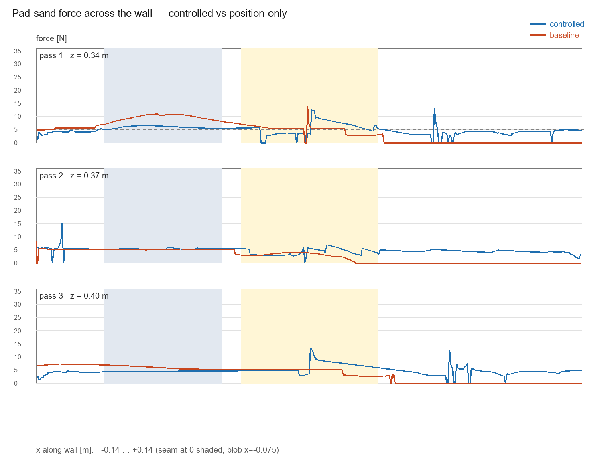
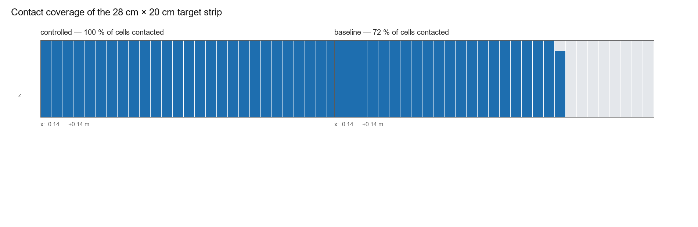
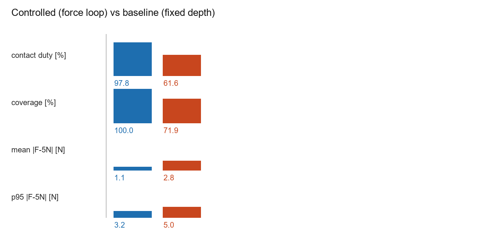

<h1 align="center">WallFin</h1>

<p align="center"><b>An open-source wall sanding and finishing robot</b></p>

<p align="center">
  <a href="LICENSE"></a>
  
  
</p>

**WallFin is a robot that presses a sanding pad against drywall with a steady 5 N push and sweeps the whole wall without gaps.** This repository is the full stack: a repeatable MuJoCo simulation, a 50 Hz force loop, a real-arm implementation for Feetech STS3215 servos, acceptance tests, and a 1080p film. The demo sands drywall; the same loop will carry a roller, a sprayer and corner tools.

<p align="center">
  <video src="https://salikshah.github.io/wall-painter-robot/wallfin_final_film.mp4" poster="https://raw.githubusercontent.com/salikshah/wall-painter-robot/main/docs/wallfin_main_cover.png" controls width="900" preload="metadata" playsinline></video>
</p>

<p align="center"><a href="docs/wallfin_final_film.mp4"><b>▶ Watch the 1:48 film</b></a> · 1080p50 · with sound</p>

> **Status — October 2026.** WallFin is a proof of concept. The simulation is complete and reproducible; the real-arm code is dry-rehearsed. No physical hardware exists yet. A physical prototype is estimated to take about 3 months to build, followed by dust extraction, calibration, safety and pilots.

## What it does

A small arm rides a vertical rail. A sanding pad on the wrist touches a test wall and holds **5 N** — about the weight of a 500 ml water bottle resting in your palm. The pad sweeps three horizontal strips while the controller keeps that push steady.

Real walls are never flat. The test wall carries three surprises you meet in real rooms:

- a **4 mm sunken seam** between two boards,
- a board that **leans away 1.5°**,
- a **screw head that stands 2.5 mm proud**.

A good sander should not mind any of them. The force loop follows the wall shape without being told where the seam or screw is.

The same run is repeated with a **fixed-depth** controller. It holds one position and trusts it. Comparing the two shows what force feedback is worth.

## The problem

Wall finishing is dusty, repetitive work. It asks for a steady hand and careful shoulders, and it is one of the last big jobs on a site still done by people.

Commercial wall-finishing robots exist. Canvas builds the 1200CX, a 1,200 lb drywall machine with a 12 ft reach. Okibo builds the EG7/EG7+, an 800 lb autonomous painter and sander that reaches 24 ft. PaintJet's Bravo paints building exteriors from a lift. They are impressive machines built for large commercial projects.

Small renovation and repainting work — most of the market by job count — has little built for it. WallFin is a study of a smaller idea: a low-cost arm, a rail, one tool at a time, and force control good enough to touch a wall carefully.

This is a research and engineering project, not a product. The simulation is done. The hardware path is written down and rehearsed without hardware.

## Results in simulation

Both runs use the same arm, wall, seeds and pass plan. Only the controller changes.

| Metric | Force loop | Fixed depth |
|---|---|---|
| Time on the wall (contact duty) | **97.8 %** | 61.6 % |
| Wall covered | **100 %** | 71.9 % |
| Average force error | **1.05 N** | 2.79 N |
| Steady force error, mean / p95 | **1.10 / 3.00 N** | 5.00 / 5.00 N |
| Biggest push | **15.0 N** | 13.8 N |
| IK failures while sanding | **0** | 0 |

- **Contact duty** is the share of the sweep where the pad is actually touching (force ≥ 1.5 N). 97.8 % means the pad is working for almost the whole pass.
- **Steady** leaves out the strip right at the seam and the screw. The pad is wide, so it feels those bumps early; the force rises for a moment, and the loop settles again in about half a second.
- **Coverage** counts 10 mm cells that received contact for at least 20 ms. 100 % means every cell in the target strip was touched.

Every number comes from fixed-seed runs and passes `sim/check_demo.py`, which also checks SHA-256 fingerprints of the recorded data. Current fingerprints: `ctl5 = e208219d5ea24829…`, `base5 = 804c7deb8551ad7d…`.







## Run it

You need Python 3.9+, a laptop, and free software. No GPU. A physics-only run takes a few minutes per mode.

```bash
git clone https://github.com/salikshah/wall-painter-robot.git
cd wall-painter-robot

python -m venv .venv
# Windows
.venv\Scripts\activate
# macOS / Linux
# source .venv/bin/activate

pip install mujoco numpy pillow
cd sim

python make_textures.py
python run_demo.py --mode controlled --passes 3 --save --tag ctl5
python run_demo.py --mode baseline  --passes 3 --save --tag base5
python check_demo.py
```

You should see `ALL GATES PASS` and both fingerprints. The runs are deterministic on purpose: seeds are fixed so two people can compare results.

Optional — rebuild the figures and cards:

```bash
python make_charts.py
python make_cards_white.py
python make_cards_launch.py
```

Rendering is the slow part. A 720p preview of one mode:

```bash
python run_demo.py --mode controlled --passes 3 --render --res 720 --tag vid
```

Full 1080p renders take hours. `sim/edit.py` builds the two demo videos from those frames. The published 1:48 film is in `docs/wallfin_final_film.mp4`; see [docs/DOCS-INDEX.md](docs/DOCS-INDEX.md) for the assembly scripts.

### The real-arm stack, without hardware

```bash
# from the repository root
python hw/check_kinematics.py
python hw/host.py --dry --passes 3
```

`--dry` stands in for the arm and the wall. It runs the same phases and the same force loop as the simulation. Nothing moves, and the numbers repeat.

## How it works

### The wall

`sim/wall_geometry.py` describes two drywall boards facing the robot. The right board sits back 4 mm at the seam and leans away 1.5°. A screw head rises 2.5 mm on the left board. One function, `wall_surface_y(x, z)`, returns the wall surface at any point. The controller uses it as a map of where the wall is. The pad still has to feel its way along; the map is how the commanded depth knows where to start.

### The pad

The pad is a 100 mm disc with a wide, 150 mm-radius dome on its face. Think of a beach ball against a wall: tilt it, and it still touches at one point. That makes the contact predictable. The contact is soft on purpose — soft enough to forgive small mistakes, firm enough to sand. In the working range the wall pushes back about 6–12 N per mm.

### The arm and IK

The arm is a stylized SO-101 with five joints. Turning "put the pad here" into joint angles is inverse kinematics (IK). It is a puzzle: many poses reach the same spot, and most of them are awkward. The solver starts from a saved bank of poses that are known to reach the wall, then refines. The pad is aimed with a small upward tilt (2 %) to balance servo sag. The worst position error across the whole sweep is 0.79 mm.

The rail is set back so the arm works extended rather than folded against its limits. That one change also softened the contact: peak force fell from 33.5 N to 15.0 N.

### The force loop

`sim/control.py` is the heart of the project and it is short.

- In the air, the pad creeps toward the wall at 15 mm/s — soft, like a hand in the dark.
- On contact, each tick nudges the depth: `p += −k_a · (f − f_des) · dt + integral`.
- A 50 ms filter keeps the force signal calm.
- A guard stops the loop from winding up when a depth is out of reach.

The output is a depth offset from the wall surface. The IK turns that into joint angles. The loop runs at 50 Hz.

### Coverage

A grid of 10 mm cells records how long each cell spent in contact. The wall "paints itself" in the render as cells pass 20 ms of contact. Coverage is the share of the target strip that passed that threshold.

## Simulation vs the real arm

The `hw/` folder runs the same control law on a real Feetech STS3215 arm, with no MuJoCo.

| Check | Result |
|---|---|
| Pad pose vs MuJoCo | 0.001 µm max (a numerical check) |
| Gravity torque vs MuJoCo | 0.04 N·m max |
| IK along the sweep | worst 0.8 mm; 3.5 ms median, 6 ms p95 per tick |
| Dry rehearsal | 100 % coverage, 4.7 N mean against a 5 N goal |

What is ready today:

- plain-numpy arm math, checked against the simulator;
- a serial driver for STS3215 servos plus a fake bus;
- force estimated from servo load with gravity correction;
- the same phase runner and force loop as the sim;
- safety: torque off on exit, temperature / voltage / force stops, an E-stop file, and an `--enable` gate;
- a full dry run that needs no hardware.

What is still ahead:

- a physical build and first wall contact;
- the rail stepper driver (bench runs use `--no-base`);
- inertia correction in the force estimate, so quick seam hits do not show 15–20 N spikes;
- dust extraction and the tool changer.

The control brain is ready; the remaining risk is in the physical build.

## From demo to prototype

| Stage | What happens | Time |
|---|---|---|
| 0 — done | Simulation, force loop, acceptance tests, real-arm code, dry rehearsal | — |
| 1 — parts | 5–7 servos, printed SO-101 parts, bus adapter, 12 V supply, rail + stepper, sanding head, camera — about ₹50–80k | 1–2 weeks |
| 2 — bench | Calibrate signs and offsets, check the load sign, gravity check, first slow moves | 1–3 weeks |
| 3 — contact | First wall touch; hold 5 N | 1–2 weeks |
| 4 — sweep | Full pass on a real wall, matching the sim's gates; dust and cables sorted | 4–8 weeks |
| 5 — product | Rail driver, tool changer, dust extraction, calibration routine, safety, pilots, certification | months |

**A physical prototype is estimated to take about 3 months after the parts arrive.** The control loop already exists; what remains is assembly and tuning, followed by dust extraction, calibration, safety and pilots.

The design target is a prototype roughly **10× cheaper than imported commercial machines**. That is a target to validate, not a claim.

## How it compares

These are real machines, built for real sites. WallFin is a simulation study, and it aims at a different corner of the work.

| | WallFin (this repo) | Canvas 1200CX | Okibo EG7 / EG7+ | PaintJet Bravo |
|---|---|---|---|---|
| What it is | small arm on a rail with a sanding pad | drywall finishing robot | autonomous painting + drywall finishing robot | exterior painting robot on a lift |
| Status | simulation + real-arm code; no prototype | commercial; acquired by JLG in Jan 2026 | commercial; CE certified; US launch 2025 | commercial service |
| Reach / size | 610 mm test wall; lab rail | 12 ft reach; 1,200 lb | up to 24 ft; 800 lb; 27 in wide | lift-based |
| Focus | small renovation, low cost | L4/L5 spray and sand, dust capture | painting and sanding, large sites | building exteriors and ships |
| Control | 5 N force loop, 50 Hz | worker-assisted | fully autonomous | remote-operated |

Vendor claims are theirs, not ours: Canvas reports 40 % fewer touchpoints and 99.9 % dust capture; Okibo reports 1,000–1,500 sq ft/h; PaintJet reports 14× faster painting and 25 % less paint. Links: [Canvas](https://canvas.build), [Okibo](https://okibo.com), [PaintJet](https://paintjet.com).

What this project takes from them: wall finishing is a real market, dust is a health problem, and force control is the part that lets a machine touch a wall without damaging it. What it adds: a small, open, low-cost path aimed at work the big machines do not serve.

## FAQ

### What is WallFin?

An open-source wall-painting and finishing robot project. Today it is a physics simulation of a small arm sanding drywall, plus control code written for a real arm. It is not a product and not a kit.

### Is there a physical robot?

Not yet. The parts, cost and bring-up steps are in [ROADMAP.md](ROADMAP.md) and [docs/guide.md](docs/guide.md).

### Why sanding first, not painting?

Sanding is the dusty, repetitive, skill-dependent part. It is also the best test of force control: the pad must stay in contact while the wall changes under it. Once that works, a roller or sprayer is a tool change.

### What is admittance control?

The robot measures the force at the pad and adjusts its target depth in response. Instead of holding a rigid position, it gives a little when the wall pushes back. That is what keeps the contact steady over a seam or a screw head.

### Why 5 N?

Five newtons is about a 500 ml water bottle resting in your palm. It is enough to sand, and light enough that a small arm can control it. The code can target other forces; 5 N is the demo setting.

### What does fixed depth do?

It holds one position and trusts it. On the flat board it presses 8–25 N — harder than we would like. Over the recessed board it floats, touching nothing. Two boards, two results, one fixed depth.

### Can I run it on a laptop?

Yes. Python 3.9+, MuJoCo, numpy and Pillow. No GPU. Physics-only runs take a few minutes; rendering takes hours. The real-arm checks and the dry rehearsal also run without hardware.

### Can I build one?

The parts list, cost and bring-up steps are documented. It is not a kit, and it will ask for patience with calibration, cables and dust. Start with `hw/README.md`.

### Is it open source?

Yes, under Apache-2.0. Fork it, change it, and keep the attribution in [NOTICE](NOTICE).

### What is still hard?

Dust, calibration, load-sign setup, real servo friction, the rail driver, safety, and certification. The simulation gets part of the way; the rest is bench work.

## Glossary

- **Admittance control** — a force loop that moves the target position in response to measured force.
- **Contact duty** — the share of the sweep with the pad touching the wall (force ≥ 1.5 N).
- **Coverage** — the share of target cells that received at least 20 ms of contact.
- **DOF** — degrees of freedom; the number of independent joint motions.
- **End effector** — the tool at the end of the arm. Here, the sanding pad.
- **FK / IK** — forward kinematics turns joint angles into a pose; inverse kinematics turns a pose into joint angles.
- **L4 / L5** — drywall finish quality levels. Level 5 is the smoothest and needs the most careful sanding.
- **MJCF** — MuJoCo's XML model format.
- **MuJoCo** — a free physics engine for contact-rich robotics.
- **SO-101** — a small, 3D-printable robot arm design by TheRobotStudio.
- **STS3215** — a serial bus servo from Feetech, used on SO-101 builds.
- **Sim-to-real** — carrying a controller from simulation onto physical hardware.
- **Digital twin** — a simulation that mirrors the real system closely enough to test decisions.

## Repository layout

```text
.
├── README.md                 this file
├── ROADMAP.md                the plan, stage by stage
├── LICENSE / NOTICE          Apache-2.0 + third-party attribution
├── docs/
│   ├── guide.md              builder's guide for a new student
│   ├── pitch.md              one-page summary
│   ├── writing.md            how we write about the project
│   ├── DOCS-INDEX.md         every file, and how to regenerate it
│   ├── wallfin_final_film.mp4  branded 1:48 launch film
│   ├── wallfin_main_cover.png  film poster / social card
│   ├── index.html            GitHub Pages landing redirect
│   ├── cards/                editable title, divider and CTA slides
│   └── *.png                 figures
├── sim/
│   ├── wall_geometry.py      scene constants + analytic wall surface
│   ├── build_model.py        MJCF builder (arm, wall, toolhead, studio)
│   ├── robot.py              arm wrapper, IK, force readout
│   ├── control.py            force loop + coverage grid
│   ├── run_demo.py           phase runner + renderer
│   ├── check_demo.py         acceptance gates + fingerprints
│   ├── edit.py               demo video assembly
│   ├── edit_launch.py        combined film assembly
│   ├── make_charts.py        figures
│   ├── make_cards_white.py   intro/end cards
│   ├── make_cards_launch.py  film cards + CTA
│   └── reports/              run data, fingerprints, shot manifests
├── hw/                       real-arm side (no MuJoCo)
│   ├── README.md             wiring, calibration, first hour
│   ├── kinematics.py         plain-numpy arm math
│   ├── check_kinematics.py   checks against the sim
│   ├── feetech.py            STS3215 driver + fake bus
│   ├── force_est.py          force from servo load
│   └── host.py               phase runner, safety, logs
└── assets/                   SO-101 URDF, textures, licenses
```

Generated frame dumps and video intermediates are not committed; they rebuild from the commands above.

## Reproducibility

- Seeds are fixed, so canonical runs repeat exactly.
- `sim/check_demo.py` checks nine acceptance gates plus the SHA-256 of the recorded arrays.
- The canonical fingerprints are `ctl5 = e208219d5ea24829…` and `base5 = 804c7deb8551ad7d…`.
- If you change the model, re-run the controlled save to a scratch tag and confirm the fingerprint before committing to a long render. Visual-only geoms must stay physics-neutral (`density="0"`, `contype="0"`, `conaffinity="0"`). Details: [docs/DOCS-INDEX.md](docs/DOCS-INDEX.md).

## Build guide

New to robotics, or want the ideas explained from zero? Read **[docs/guide.md](docs/guide.md)**. It covers the job, the machine, MuJoCo, IK, force control, coverage, reproducibility, the real-arm path, the product plan and the landscape — with exercises at the end. About 30–45 minutes.

## Roadmap

[docs/guide.md](docs/guide.md) explains the ideas. [ROADMAP.md](ROADMAP.md) is the estimated path: prototype, tool changer, rail driver, dust, pilots, and possible early users.

## Contributing

Issues and pull requests are welcome. Before sending a change:

1. Run `python sim/check_demo.py` and keep both fingerprints intact.
2. Run `python hw/check_kinematics.py` if you touched the hardware math.
3. Keep claims sourced and numbers reproducible.
4. Match the writing in [docs/writing.md](docs/writing.md): short sentences, plain words, honest limits.

There is no hardware kit yet. If you build a prototype, open an issue and share what you learn.

## License and attribution

WallFin is released under the **Apache License 2.0**. See [LICENSE](LICENSE) and [NOTICE](NOTICE).

- SO-101 / SO-ARM100 description: TheRobotStudio (Laurent Genoud), Apache-2.0.
- MOSS × Jev (`metrox-eth/moss-jev`): the IK core and kinematic build pattern are adapted from it, Apache-2.0.
- MuJoCo: Google DeepMind, Apache-2.0.
- Everything else here was written for this project.

## Contact

**Salik Shah**

- GitHub: [@salikshah](https://github.com/salikshah)
- X: [@salik](https://x.com/salik)
- Email: [salik.shah@gmail.com](mailto:salik.shah@gmail.com)

If you work in construction, real estate, manufacturing or deep tech, I would like to hear how you are bringing AI and robotics into your physical stack. If you build a prototype, I would like to hear how it goes.
